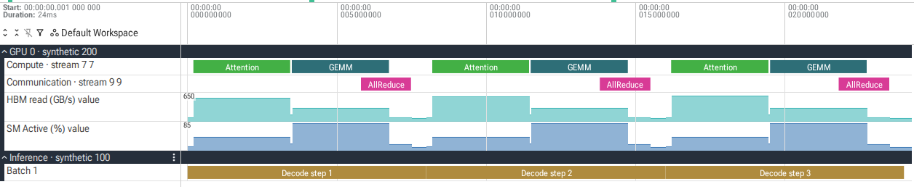

<p align="center">
  
</p>
<h1 align="center">看清一次推理里的计算与带宽</h1>
<p align="center">
  <strong>把一轮 LLM 推理的阶段、GPU 计算和数据传输放在同一条时间轴上。</strong><br>
  Read GPU work and data movement together, one inference step at a time.
</p>
<p align="center">
  <a href="#先看一个-decode-step">看示例</a> · <a href="#转换自己的-trace">转换自己的 trace</a> ·
  <a href="#开发路线">开发路线</a> · <a href="https://ui.perfetto.dev/">打开 Perfetto ↗</a>
</p>

一次 Decode 里，AllReduce 开始时，另一条 CUDA stream 上的 GEMM 还在跑吗？ServeUtil 把冗长的 kernel 名缩成可读标签，保留每条 stream 的起止时间。输入里已有的带宽和计算活跃度样本也会出现在同一窗口，点开事件仍可查到原名。

**当前可用：单份 PyTorch trace 的离线概览导出器。** 已有的采集可以直接重读。随推理同步采集硬件指标、多 rank 对齐和跨节点 KV 传输分析列在开发路线中。

## 先看一个 Decode step



这是 Perfetto 打开仓库样例的实际画面。样例中的三个 step 和两条指标曲线均为合成数据，仅用于演示读图。

1. 下载[可直接打开的样例](examples/decode.perfetto.json)。在 GitHub 文件页可使用 **Download raw file**。
2. 在 [Perfetto](https://ui.perfetto.dev/) 选择 **Open trace file**。展开 `GPU 0 · synthetic` 和 `Inference · synthetic`。
3. 找到第一个 `Decode step`。沿时间轴看，粉色 `AllReduce` 在青色 `GEMM` 结束前就已开始。点一下 `GEMM`，在详情的 `serveutil.original_name` 中可以找到完整 kernel 名。

## 转换自己的 trace

在仓库根目录运行，需要 Python 3.10 或以上。转换过程只读本地文件，可以在没有 GPU 或 PyTorch 的机器上完成。

```bash
python -m pip install .
serveutil examples/decode.synthetic.json -o decode.overview.json
```

把输入替换为 `torch.profiler` 导出的 Chrome JSON，或 SGLang 保存的单 rank 压缩 trace，例如：

```bash
serveutil TP-0.trace.json.gz -o rank0.overview.json
```

输出是可直接在 Perfetto 打开的 JSON。原始 trace 保留，后续可以用新的显示规则重新导出。指定的输出文件在成功后会被替换。

| 概览里的内容 | 如何阅读 |
|---|---|
| 阶段标记 | 保留框架记录的完整 CPU/GPU 用户区间。能看到哪些 step 取决于输入中的标记。 |
| GPU 工作 | 保留 kernel、memcpy、memset 的时间与轨道。可识别的 kernel 简写为 GEMM、Attention 或具体集合通信，未知名称保留函数短名。 |
| 指标曲线 | 透传输入已有的 Chrome counter 事件及其单位语义。输入缺少硬件采样时，文件只展示已记录的事件。 |

## 开发路线

| 进度 | 目标 | 验收方式 |
|---|---|---|
| 已有原型 | 从单 rank trace 导出离线概览 | 真实 H20 prefill trace 已完成转换；仓库合成样例可在 Perfetto 中检查并发轨道和 counter。 |
| 下一步 | 同一轮 workload 同时采集计算与带宽 | 在 H20 双卡上对齐 Decode step、每卡 SM/Tensor 活跃度、HBM 读写、NVLink 和 PCIe 收发，记录来源与采样粒度。 |
| 后续 | 解释跨节点 KV cache 交接 | 把传输 ID、源端发送、目的端接收和 Decode 开始时间关联起来，分别显示单笔传输有效带宽与端口总带宽。 |

设计上优先复用 PyTorch/Kineto、llmperfscope 和设备计数器；通用时间线交给 Perfetto。更详细的指标口径、环境验证和下一步实验见[项目交接文档](NEXT_AI_HANDOFF.md)。

[PyTorch Profiler](https://docs.pytorch.org/docs/stable/profiler.html) · [llmperfscope](https://github.com/developer0hye/llmperfscope) · [Perfetto 的 trace 格式](https://perfetto.dev/docs/getting-started/other-formats)

## 许可证

ServeUtil 采用 [Apache License 2.0](LICENSE)，项目署名见 [NOTICE](NOTICE)。
