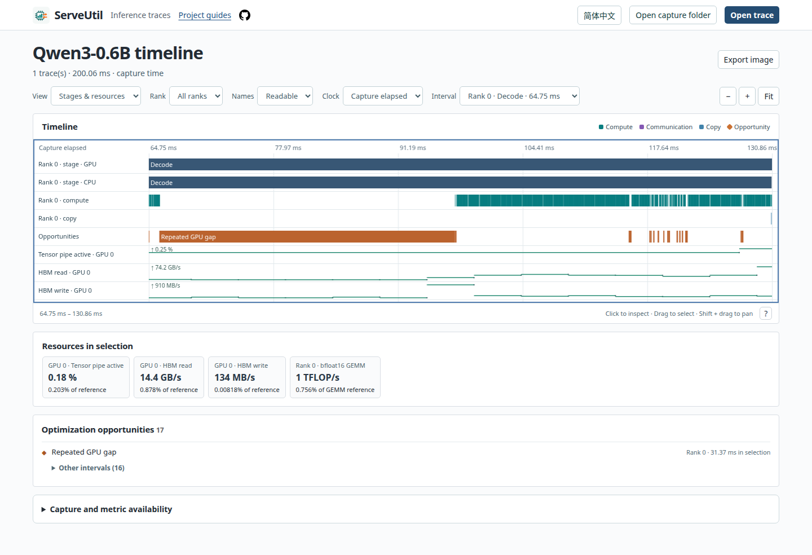

<p align="center"></p>
<h1 align="center">面向大模型推理的计算与带宽分析</h1>
<p align="center"><strong><a href="https://haoyangping0324.github.io/ServeUtil/zh/">项目文档</a> &nbsp;|&nbsp; <a href="https://haoyangping0324.github.io/ServeUtil/viewer.html?lang=zh">网页版查看器</a> &nbsp;|&nbsp; <a href="https://haoyangping0324.github.io/ServeUtil/zh/downloads.html">客户端下载</a> &nbsp;|&nbsp; <a href="README.md">English</a></strong></p>
<p align="center">
  <a href="https://github.com/HaoyangPing0324/ServeUtil/actions/workflows/desktop.yml"></a>
  <a href="#安装"></a>
  <a href="LICENSE"></a>
  <a href="https://haoyangping0324.github.io/ServeUtil/zh/capture.html"></a>
</p>

ServeUtil 面向 PyTorch、vLLM 和 SGLang。打开一次 Decode，先看各个 rank 在什么时候计算、通信或等待，再选中一段 AllReduce，查看消息大小、两端带宽，以及这段传输达到了本机实测参考值的百分之几。



## 在 torch.profiler 和 Perfetto 上增加了什么

| 你手上的数据或问题 | ServeUtil 提供的扩展 |
|---|---|
| `torch.profiler` 录到了算子、CUDA kernel 和拷贝，这段时间硬件实际有多忙？ | 保留原始 trace，在同一时间轴附加设备级采样。按可用后端显示 HBM 读写、PCIe 与 NVLink 收发、节点网口与 RDMA 端口带宽，以及 SM、Tensor 和精度流水线活跃度。 |
| 看到 58 MB/s，怎样判断它有多高？ | 用同一设备、方向和测量口径的微测结果作为分母。选区卡片同时给出绝对量、利用率和参考负载。有输入形状且能唯一关联到 kernel 的 dense GEMM 还可显示有效 TFLOP/s。 |
| Perfetto 中有许多嵌套的算子和并行轨道，该从哪里看？ | 默认从 Prefill、Decode 和资源使用看全局，再按节点、rank、算子层级或叶子展开。通信视图可沿配对的 Send/Recv 查看对端，也能查看 PD 分离的 KV 交接证据。 |
| 哪些区间值得细看？ | 标记重复 GPU 空档、缺少计算重叠的通信、持续带宽压力和可比较的 rank 耗时差异。点击标记查看触发依据。需要原始事件、flow 或 SQL 时，在同一份报告切到 **Full Perfetto**。 |

例如，两台 H20 上的 SGLang TP2 在一次单并发推理的 3.05 秒选区内平均发送约 58.5 MB/s，约为同向 eRDMA 端口实测基线的 0.51%。同一选区 4,469 次完整 AllReduce 中有 3,956 次载荷仅 2 KiB。把消息大小、计算间隔和端口读数放在一起，才能解释这个百分比。[模型与两端计数器实测](docs/validation.md)

## 安装

需要 Python 3.10 或更高版本。PyPI 发行版使用下面的命令安装。首次公开发布前，有仓库权限的用户可在源码根目录执行 `python -m pip install .`。

```bash
pip install serveutil
serveutil --help
```

基础安装包含命令行、浏览器查看器和 NVIDIA NVML 绑定。打开已有 trace 可以使用普通电脑。采集模型时使用推理环境已有的 PyTorch 或模型服务。Linux 上需要通过 CUPTI 独立测量分方向 HBM 读写时，安装 `pip install "serveutil[pm]"`，并确保驱动和设备允许读取性能计数器。原生桌面窗口可用 `pip install "serveutil[desktop]"` 安装。[指标来源与支持条件](docs/metrics.md)

## 第一次使用

**已经有 trace** 时，一条命令即可本地打开。也可以把多个 rank 的文件拖入窗口，或导入整个采集目录。需要一份可分享的离线报告时执行第二行。

```bash
serveutil view rank0.pt.trace.json.gz
serveutil report rank0.pt.trace.json.gz -o report.html
```

**自己的 PyTorch 程序**可以把待测代码放入 `serveutil.profile`。下面的例子可独立运行，CPU 和 CUDA 环境均可使用。将线性层替换成自己的模型即可采集实际推理。

```python
import torch
import serveutil

device = "cuda" if torch.cuda.is_available() else "cpu"
projection = torch.nn.Linear(256, 256, bias=False).to(device).eval()
x = torch.ones(32, 256, device=device)

with torch.inference_mode(), serveutil.profile("runs", record_shapes=True) as prof:
    with torch.profiler.record_function("Projection"):
        projection(x)
    prof.step()

print(prof.serveutil_directory / "report.html")
```

`prof` 就是原生 `torch.profiler.profile` 对象。默认在首次 CUDA 采集前标定所选设备，后续复用缓存。已有原生 schedule、TensorBoard 回调或异步导出的项目还可用 `instrument` 或 `observe` 接入。[PyTorch 集成示例](docs/torch-profiler.md)

**已经运行的 vLLM 或 SGLang 服务**需要先启用框架的 PyTorch profiler。以单 GPU 为例，vLLM 启动时增加 `--profiler-config '{"profiler":"torch","torch_profiler_dir":"/profiles"}'`。SGLang 启动前设置 `SGLANG_TORCH_PROFILER_DIR=/profiles`。服务和采集端都要能访问对应的 trace 目录。随后选择与服务对应的一条命令。

```bash
serveutil capture --engine vllm --url http://localhost:8000 \
  --trace-dir /profiles --seconds 5 --generate "Explain prefill and decode."

serveutil capture --engine sglang --url http://localhost:30000 \
  --trace-dir /profiles --seconds 5 --generate "Explain prefill and decode."
```

命令会预热并发出请求，通知模型 worker 启停原生 profiler，同时采集硬件指标，最后打印 `report.html` 路径。已有业务流量时省略 `--generate`。空闲测试设备可用 `--calibrate` 获取基线，或用 `--calibration calibration.json` 复用已有结果。多节点或 PD 分离只需先写一次拓扑文件，之后每次仍用一条采集命令。[服务采集指南](docs/capture.md) · [多节点拓扑](examples/distributed-topology.json) · [PD 拓扑](examples/pd-topology.json)

## 样例与进一步使用

- 下载并用浏览器打开两份实测节选，看看如何从一次 Decode 定位 GPU 空档，或从两个 rank 的集合通信查到消息大小和参考带宽。[Qwen3 Decode](examples/h20-decode.html) · [SGLang 双卡 AllReduce](examples/h20-allreduce.html)
- 了解节点与 rank 筛选、原始名称、算子深度、通信配对、完整 Perfetto 和数据导出。[查看器指南](docs/viewer.md)
- 核对利用率分母、短窗口采样精度、真实双机结果与 profiling 开销。[指标定义](docs/metrics.md) · [实测记录](docs/validation.md)
- 使用 nvbandwidth、nccl-tests、RDMA perftest 做标定，或接入 HTA、TraceLens 和 llmperfscope。[已有工具与对应入口](docs/tools.md)

ServeUtil 采用 Apache License 2.0，随包分发的组件保留上游许可。[许可证](LICENSE) · [第三方声明](NOTICE)
